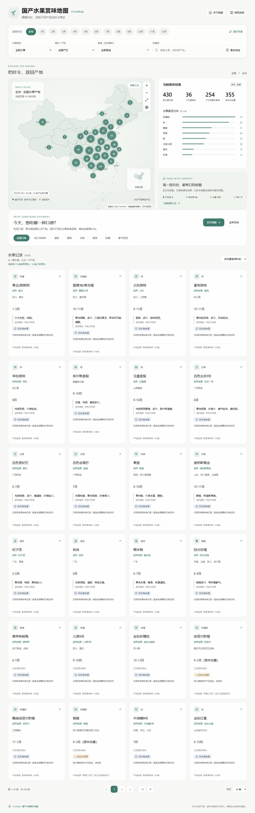
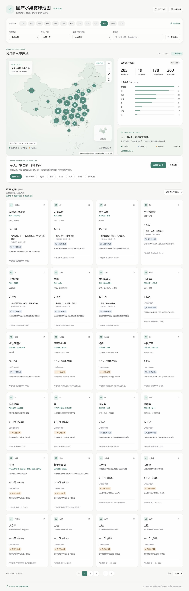
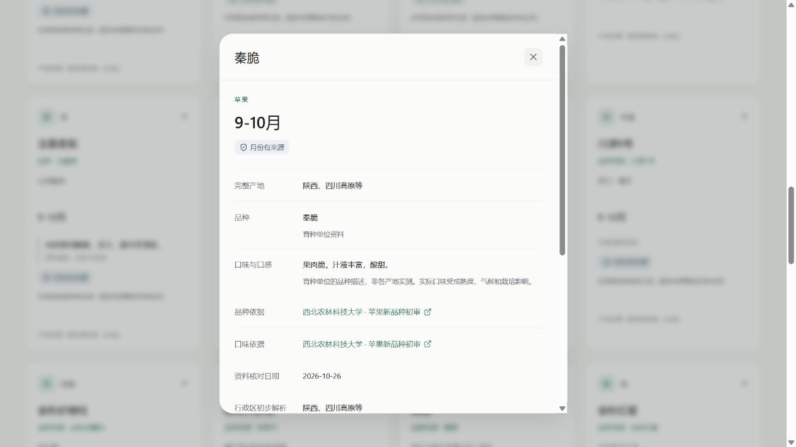
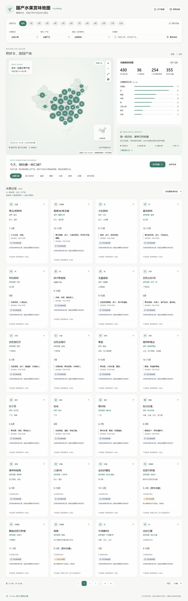

# FruitMapCN · 国产水果赏味地图

**按时、按季吃水果。** 选一个月份，看看各地有什么水果，再了解品种、口味和资料来源。

FruitMapCN 是一个可本地运行的桌面 Web 应用，使用 React / TypeScript / FastAPI / SQLite。由原「国产水果赏味地图 HTML Demo」重构而来：保留地图探索体验，把数据导入、清理、查询和展示分开维护。当前专注电脑浏览器。



## 能做什么

- 按月份、类目、省县、关键词和口味筛选，地图、统计、列表同步更新。
- 用省级气泡汇总产区，支持拖动、缩放、恢复默认视角和完整全国视图。
- 从「本月尝鲜」「全年风味」进入探索，查看品种、口味、适用范围和来源。
- 区分月份已核验、有来源、估算和待补，资料不足时保留空白。

<details>
<summary>展开查看操作截图</summary>



选择月份后，统计、地图与水果列表一起变化；气泡数字表示当前筛选下的记录数。



详情将产地资料、月份依据、品种和口味来源分开展示。口味为定性描述，不能当作具体批次的实测值。



默认视角便于探索主要产区；完整全国视图与缩略图用于查看全部边界要素。

</details>

截图来自维护者的本地数据实例。**仓库和 Release 不包含水果数据库、主表 Excel、资料清单或可还原全量数据的旧 HTML。** 克隆后可以运行空库界面；展示自己的数据需要自行导入主表。这里发布的是应用源码与说明，不是在线水果查询服务。

## 数据怎么维护

```text
本地主表 Excel → 校验 / 预演 / 事务导入 → SQLite 原始记录
                                         ↓
本地来源资料清单 → 镇级产地整理 / 重复关联 / 品种口味补充
                                         ↓
                             统一查询视图 → API → 桌面页面
```

| 管理能力 | 当前实现 |
| --- | --- |
| 可重复导入 | 稳定 UID + 内容摘要，区分新增、更新和未变；错误阻止整批写入 |
| 保留原始资料 | 原始表与清理层分离，展示产地最细到乡镇；没有乡镇依据时退到县级 |
| 证据分层 | 产地、月份、品种、口味各有来源；产区代表品种不冒充本条已核实品种 |
| 可审计 | 预演报告、重复关联、清理统计、SQLite 一致性备份 |
| 数据隔离 | 服务端分页与聚合，无数据库下载或全量导出接口；原文件不进静态目录 |

本地首轮整理保留 441 条原始关联，合并 11 条重复后展示 430 条；其中 35 条具有品种字段，16 条具有独立口味依据。月份核验与风味补充是不同维度，补口味不会升级月份状态。这些数字仅描述截图所用实例，不代表公开包自带数据。公开网页仍可能被逐页抓取；需要限制访问时启用私有模式。

## 快速开始

建议 Python 3.11+、Node.js 22.12+、pnpm 10+。以下命令在 Windows CMD 中执行：

```bat
git clone https://github.com/Starlightchaser/FruitMapCN.git
cd FruitMapCN
python -m venv .venv
.venv\Scripts\python.exe -m pip install -r backend\requirements.lock.txt
.venv\Scripts\python.exe -m pip install --no-deps -e ".\backend[test]"
copy .env.example .env
cd frontend
pnpm install --frozen-lockfile
pnpm run build
cd ..
Start-FruitMap.cmd
```

打开 <http://127.0.0.1:8018>；Ctrl+C 停止。已有 `.env` 时保留原配置。DataV 本地边界不需要地图 Key；下载边界和本地显示不会产生地图接口调用费用。公开部署仍须独立核对地图来源、用途和审图信息，当前保持未完成发布核验状态。

吃水果的操作步骤见 [操作手册](docs/USER-GUIDE.md)；详细 CMD、安装与常见问题见 [CMD-GUIDE.md](CMD-GUIDE.md)；主表格式、导入和备份见 [数据管理](docs/DATA-MANAGEMENT.md)。

## 项目结构

```text
backend/app/            API、SQLite 模型、月份解析、导入与清理
backend/assets/maps/    DataV 原始边界与来源摘要
backend/tests/          导入、查询、权限、迁移与清理测试
frontend/src/           桌面页面、地图与省级气泡、交互测试
data/                   本地数据工作区；仅空白结构示例进入 Git
docs/                   操作手册、数据管理、开发说明与截图
scripts/                边界更新、源码发布检查
Start-FruitMap.cmd      Windows 日常启动入口
```

测试、API 与部署说明见 [开发说明](docs/DEVELOPMENT.md)，版本变化见 [CHANGELOG.md](CHANGELOG.md)。

## 与已有方案的侧重点

| 方案 | 已有侧重点 | FruitMapCN 的选择 |
| --- | --- | --- |
| 原 HTML Demo（用户提供） | 小数据量的月份、地图和风味探索，开箱展示直观 | 延续探索思路，将嵌入式数据改为可追溯导入、清理层和服务端查询 |
| [Seasonal Food Guide](https://www.seasonalfoodguide.org/about) | 按美国州、时段和食材查询当季信息，解释季节差异 | 面向中国水果产区，补充地方产品名、品种口味与月份证据状态 |
| [北京「京果飘香」采摘地图](https://www.forestry.gov.cn/c/www/slgs/591759.jhtml) | 展示果园位置、品种、采摘时间并支持导航 | 当前用于按季了解水果与产区；不提供果园预约、库存或导航 |

这些是产品定位对比，不是对它们数据质量的评判。后两项仅作公开资料对照，没有复制其代码或数据；FruitMapCN 的资料覆盖仍有限，不应把估算月份当作本地当年的实际采收预报。

## 后续优化方向（占坑）

- [ ] **先补证据**：优先核对常见水果的上市月份、适用产区与来源日期，建立待核验队列。
- [ ] **细化赏味窗口**：区分露地采收、设施栽培、冷藏供应和适口阶段，表达跨年与多季情况。
- [ ] **补齐品种与风味**：建立别名和品种表，保留产区参考 / 品种共性 / 实测记录的区别。
- [ ] **更可靠的地域模型**：拆分跨省关联、校验行政区编码，避免重复计数；有可靠资料后再增加市级下钻。
- [ ] **让探索更有用**：桌面月份对比、相近风味推荐、本地收藏和季节清单，不引入购买排名。
- [ ] **维护流程**：来源失效检查、批量校验、人工审核界面、变更记录与定期备份。
- [ ] **部署完善**：完成地图公开使用核验，提供私有部署示例与共享限流方案。移动端适配暂不列入当前版本。

以上均是后续计划，不代表已实现。

## 致谢与来源

感谢用户提供的原 HTML Demo、最终主表与 UI 参考，帮助明确“按季探索＋品种口味”的方向。原 HTML 是交互参考，不作为已核验的水果事实来源。

地图来自 [阿里云 DataV GeoAtlas](https://datav.aliyun.com/portal/school/atlas/area_selector)，保留原始边界及来源摘要；详见 [地图说明](docs/MAP-NOTES.md)。项目使用 [React](https://react.dev/)、[TypeScript](https://www.typescriptlang.org/)、[Vite](https://vite.dev/)、[FastAPI](https://fastapi.tiangolo.com/)、[SQLite](https://www.sqlite.org/)、[openpyxl](https://openpyxl.readthedocs.io/) 和 [Lucide](https://lucide.dev/)。

水果资料的政府、农业部门、科研育种单位等来源按记录展示；引用不代表机构参与或背书。第三方代码与地图保留各自许可和使用条件；本仓库不授予未发布数据库的使用权。代码许可待后续版本明确。
